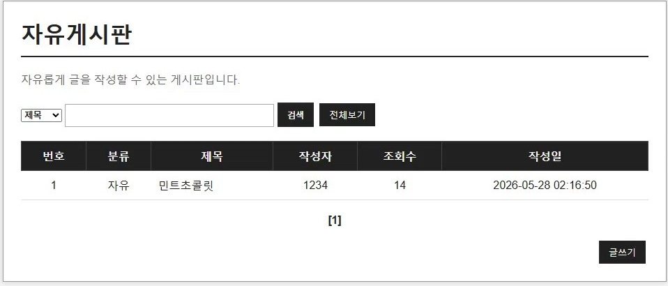
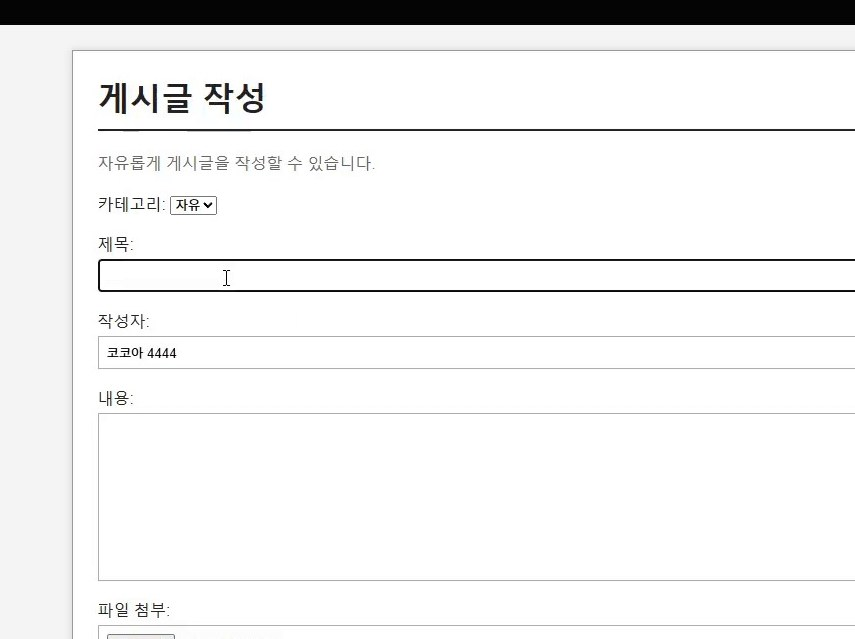
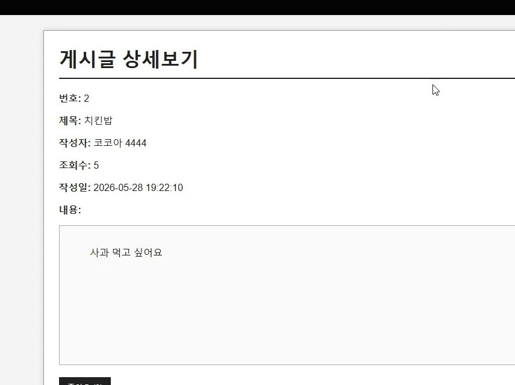
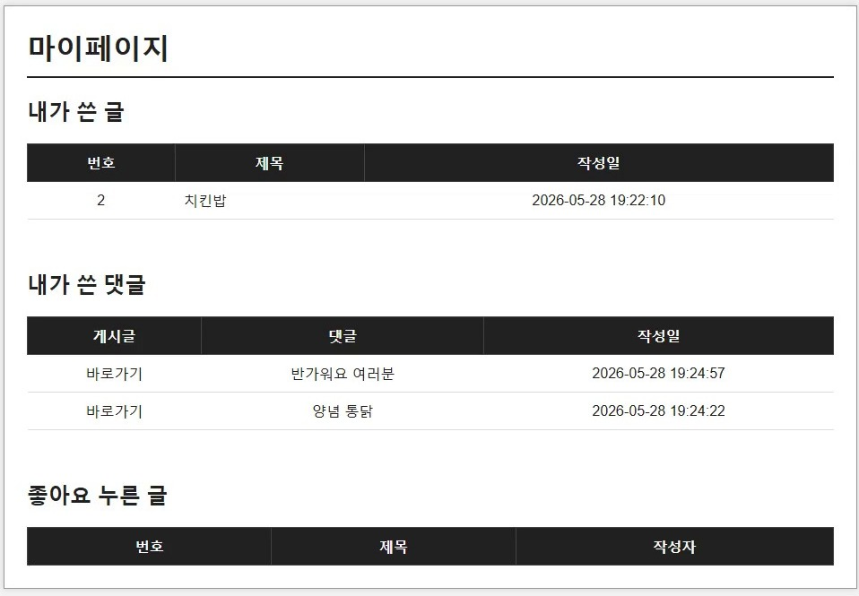
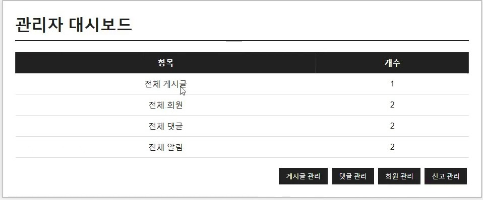

# K-board — Java·JSP 기반 웹 커뮤니티 게시판

Java, JSP, JDBC, MySQL을 활용해 게시판과 사용자·관리자 기능을 구현한 웹 애플리케이션 프로젝트입니다. 
개발 시연 영상과 소스코드를 바탕으로 정리한 채용용 포트폴리오 저장소입니다.

## 프로젝트 개요

- **유형:** Java 웹 애플리케이션 학습 프로젝트
- **주요 기술:** Java 17, JSP, JDBC, MySQL, HTML, CSS, JavaScript
- **실행 환경:** Apache Tomcat 9.0.71, Eclipse
- **코드 구성:** `src/main/java`(DAO·DTO·DBUtil), `src/main/webapp`(JSP·CSS)

## 주요 구현 기능

| 분류 | 구현 기능 |
| --- | --- |
| 회원 | 회원가입, 로그인·로그아웃, 세션 기반 로그인 상태 관리 |
| 게시판 | 글 작성·상세조회·수정·삭제, 조회수, 검색, 페이징 |
| 소통 | 댓글·대댓글, 좋아요, 알림, 게시글 신고 |
| 마이페이지 | 작성 글·댓글·좋아요 내역 조회 |
| 관리자 | 회원·게시글·댓글·신고 관리, 대시보드 |

> 화면 이미지에는 시연 영상에서 추출한 장면을 사용했습니다. 위 기능의 존재는 영상과 소스에서 확인한 범위에 근거하며, 전체 기능의 자동화 테스트 완료를 뜻하지 않습니다.

## 실행 화면

**게시글 목록 및 검색**



**게시글 작성**



**게시글 상세 조회**



**마이페이지**



**관리자 대시보드**



## 설계·코드 설명

- `dao/`: `BoardDAO`, `MemberDAO`, `CommentDAO`, `NotificationDAO` — JDBC와 SQL을 이용한 DB 접근
- `dto/`: 게시글, 회원, 댓글, 알림 데이터를 담는 DTO
- `util/DBUtil.java`: MySQL 연결 유틸리티. 공개 저장소용으로 DB 계정·비밀번호를 환경변수에서 읽도록 수정
- `webapp/`: JSP를 통한 페이지 표시와 요청 처리, CSS

## 실행 준비

1. JDK 17, Eclipse(웹 개발 도구), Apache Tomcat 9 및 MySQL을 준비합니다.
2. MySQL에 프로젝트용 데이터베이스 `boarddb`를 만들고 **필요한 테이블을 구성**합니다.
3. 다음 환경변수를 설정합니다. Eclipse/Tomcat 실행 프로세스에도 동일하게 전달돼야 합니다.

   ```text
   KBOARD_DB_URL=jdbc:mysql://localhost:3306/boarddb?serverTimezone=Asia/Seoul
   KBOARD_DB_USER=<본인 MySQL 계정>
   KBOARD_DB_PASSWORD=<본인 MySQL 비밀번호>
   ```

4. Eclipse에 기존 프로젝트로 가져온 뒤 Tomcat 9 서버를 지정해 실행합니다.

**주의:** 원본 압축파일에는 DB 테이블 생성 SQL이 포함되어 있지 않습니다. 따라서 현재 저장소만으로는 DB 초기 설치를 자동화할 수 없습니다. 실행 검증 전 스키마를 별도로 준비해야 합니다. `WEB-INF/lib`에는 원본 프로젝트의 JDBC 드라이버 및 업로드 관련 JAR 파일이 포함되어 있습니다.

## 개선 과제

- 게시글 수정·삭제, 관리자 기능의 서버 측 접근 권한 검증 강화
- 비밀번호 단방향 해시 처리 및 인증·세션 관련 보안 개선
- JDBC 예외 처리와 데이터 검증 방식 개선
- DB 초기화 스크립트 및 자동화 테스트 추가

## 파일 안내

`docs/screenshots/`는 시연 영상의 화면을 보여줍니다. `.metadata`, `build`, `Servers` 등 개인 Eclipse 작업 환경과 컴파일 결과는 공개용 파일에서 제외했습니다. 원본 프로젝트의 DB 접속 문자열에 있던 비밀번호도 제거했습니다.
